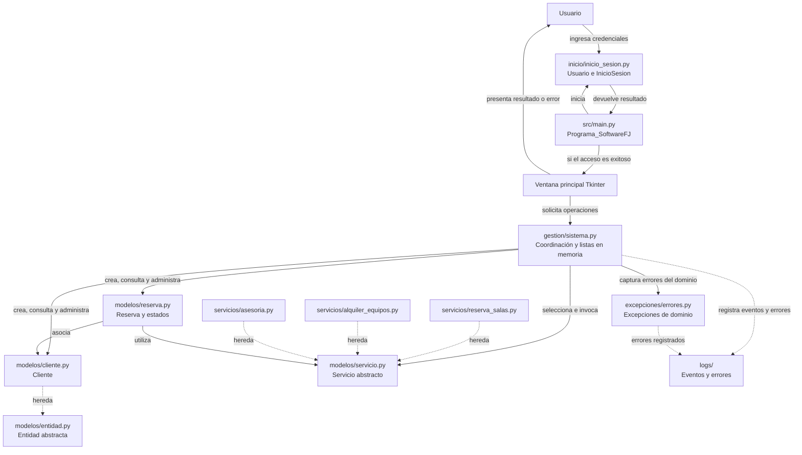
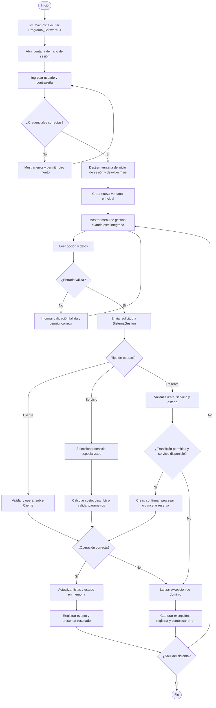

# Sistema Integral de Gestión de Clientes, Servicios y Reservas para la empresa Software FJ

Proyecto académico colaborativo para desarrollar una aplicación orientada a objetos que permita gestionar clientes, servicios y reservas de la empresa **Software FJ** mediante una interfaz gráfica sencilla.

El sistema contiene tres líneas de servicio: **reserva de salas**, **alquiler de equipos** y **asesorías especializadas**. Su diseño debe ser modular, extensible
y resistente a errores: las operaciones inválidas se informan y registran sin interrumpir el funcionamiento general de la aplicación.


## Contexto y propósito

El proyecto busca desarrollar un sistema para la empresa Software FJ, capaz de gestionar clientes, servicios y reservas mediante programación orientada a objetos.

La información se administra durante la ejecución utilizando objetos y listas internas, sin emplear bases de datos. Los archivos se utilizan únicamente para registrar eventos y errores generados durante el funcionamiento del programa.


## Objetivos

- Modelar entidades del dominio mediante clases con responsabilidades claras.
- Aplicar abstracción, herencia, polimorfismo y encapsulación.
- Validar los datos y parámetros antes de aceptar operaciones.
- Crear, confirmar, cancelar y procesar reservas asociadas a clientes y
  servicios.
- Comunicar errores de dominio mediante excepciones personalizadas.
- Registrar eventos relevantes y errores en archivos dentro de `src/logs/`.
- Mantener la aplicación operativa cuando una entrada o una operación falle.
- Integrar las funciones en una interfaz gráfica con Tkinter y demostrar al
  menos diez operaciones completas, exitosas y fallidas.

## Alcance funcional

### Gestión de clientes

La clase abstracta `Entidad` establece el concepto y las propiedades comunes a las entidades del sistema.

 `Cliente` la especializa y encapsula los datos
personales, exponiendo únicamente las operaciones definidas por la interfaz de la clase. 
Se debe someterse a validaciones estrictas para
evitar valores inválidos o incompletos.

### Gestión de servicios

La clase `Servicio` define el comportamiento común de los servicios.
Las clases concretas representan:

1. Reserva de salas.
2. Alquiler de equipos.
3. Asesorías especializadas.

Cada especialización debe sobrescribir los comportamientos que dependan del tipo de servicio. De esta manera, el sistema puede trabajar con la
interfaz general `Servicio` y delegar el comportamiento particular a cada clase.

### Gestión de reservas

`Reserva` representa la relación entre un cliente y un servicio, junto con la duración, la información necesaria para procesarla y su estado. Debe controlar
las transiciones permitidas y ofrecer operaciones para crear, confirmar, cancelar y procesar reservas. 

Debe generar error controlado: una transición no permitida, un dato inconsistente o un servicio no disponible y debe quedar registrado cuando corresponda.

### Inicio de sesión

`src/inicio/inicio_sesion.py` contiene las clases `Usuario` e `InicioSesion` y la
función `Abrir_Ventana_Inicio_Sesion()`. La función crea la ventana de acceso,
ejecuta su bucle de eventos y devuelve `True` si las credenciales se validaron
correctamente o `False` si se cerró el login sin iniciar sesión.

Las credenciales de demostración definidas actualmente son:

- Usuario: `SoftwareFJ`
- Contraseña: `SoftwareFJ`

Si las credenciales son incorrectas, el mensaje se muestra en la misma ventana
para permitir otro intento. Si son correctas, se muestra el mensaje de éxito y,
después de dos segundos, se destruye la ventana de inicio de sesión.

### Menú e integración

`src/main.py` es el punto de entrada de la aplicación. La clase
`Programa_SoftwareFJ` llama a `Abrir_Ventana_Inicio_Sesion()`. Si esta devuelve
`True`, crea una nueva ventana raíz de Tkinter para el sistema; si devuelve
`False`, no abre la ventana principal.

Actualmente, la ventana principal muestra el título y el subtítulo de Software
FJ. La integración de las opciones de gestión de clientes, servicios y reservas
está pendiente.

La carpeta `src/gestion/` tendrá la responsabilidad de coordinar los diferentes
módulos del proyecto y mantener las listas internas de clientes, servicios y
reservas. La interfaz deberá validar las entradas y permitir continuar
utilizando el programa cuando ocurran errores recuperables.

### Registro y manejo de errores

`src/excepciones/` concentra las excepciones propias del dominio. 
`src/logs/` contiene los archivos de registro generados durante la ejecución; los errores y los eventos relevantes deben dejar información suficiente para entender qué operación ocurrió sin incluir datos innecesarios.

El flujo de la aplicación debe aplicar, según el caso, bloques `try/except`, `try/except/else` y `try/except/finally`, además de encadenamiento de excepciones cuando un error de bajo nivel se transforme en uno del dominio.
Los errores no deben ocultarse ni convertirse en resultados que aparenten éxito.

## Arquitectura y estructura propuesta

```text
Sistema-Gestion-Software-FJ/
├── src/
│   ├── main.py
│   ├── inicio/
│   │   └── inicio_sesion.py
│   ├── modelos/
│   │   ├── __init__.py
│   │   ├── entidad.py
│   │   ├── cliente.py
│   │   ├── servicio.py
│   │   └── reserva.py
│   │
│   ├── servicios/
│   │   ├── __init__.py
│   │   ├── reserva_salas.py
│   │   ├── alquiler_equipos.py
│   │   └── asesoria.py
│   │
│   ├── excepciones/
│   │   ├── __init__.py
│   │   └── errores.py
│   │
│   ├── gestion/
│   │   ├── __init__.py
│   │   └── sistema.py
│   │
│   └── logs/
│       └── .gitkeep
│
├── README.md
└── .gitignore
```

### Diagrama de arquitectura

La aplicación se organiza en capas. El punto de entrada recibe las opciones del usuario; la capa de gestión coordina los objetos y las colecciones en memoria;
los modelos contienen las reglas del dominio. Las excepciones y el registro acompañan las operaciones para informar y diagnosticar errores sin almacenar
los datos del negocio en archivos.



### Diagrama de flujo de datos



Los clientes, servicios y reservas viven en las colecciones del sistema durante la ejecución. Los archivos de `src/logs/` guardan únicamente trazas de eventos y errores relevantes: no son una base de datos ni una fuente de persistencia del negocio. Cuando una operación falla, no debe dejar cambios parciales en las
listas o en el estado de una reserva.

El flujo de gestión posterior al inicio de sesión representa el alcance previsto
del sistema. Las opciones de clientes, servicios y reservas todavía deben
integrarse en la ventana principal.


## Distribución del trabajo y responsabilidades

La distribución propuesta asigna un módulo principal a cada integrante y reserva la integración general al quinto integrante. 

| Integrante | Tema | Ubicación en el proyecto | Responsabilidad | Entregable principal |
|---|---|---|---|---|
| **1** | Gestión de clientes, estructura inicial y documentación (README) | `src/modelos/entidad.py`<br>`src/modelos/cliente.py`<br>`src/main.py`<br>`README.md` | Desarrollar la clase abstracta `Entidad` y la clase `Cliente`, incluyendo encapsulación y validaciones. Crear la estructura inicial de `main.py` y elaborar la documentación inicial del proyecto en el README. | Clase `Cliente` funcional y validada, estructura inicial ejecutable de `main.py` y README organizado con la arquitectura, distribución y requisitos del proyecto. |
| **2** | Gestión de servicios | `src/modelos/servicio.py`<br>`src/servicios/` | Desarrollar la clase abstracta `Servicio` y las clases especializadas para reserva de salas, alquiler de equipos y asesorías especializadas, aplicando herencia, polimorfismo y validaciones. | Clase `Servicio` y los tres tipos de servicio funcionando individualmente, con sus métodos de validación, descripción y cálculo correspondientes. |
| **3** | Gestión de reservas | `src/modelos/reserva.py` | Desarrollar la clase `Reserva`, relacionando clientes y servicios, y controlar su creación, confirmación, cancelación y procesamiento. | Clase `Reserva` funcional, capaz de controlar correctamente sus estados y las transiciones permitidas. |
| **4** | Excepciones y registros | `src/excepciones/`<br>`src/logs/` | Crear las excepciones personalizadas del sistema y configurar el registro de eventos y errores generados durante la ejecución. | Excepciones personalizadas disponibles para los demás módulos y generación de archivos de log con eventos y errores controlados. |
| **5** | Integración, interfaz gráfica y pruebas | `src/gestion/`<br>`src/main.py` | Integrar los módulos de clientes, servicios y reservas; desarrollar la interfaz gráfica sencilla a partir de la estructura inicial de `main.py`; coordinar las listas internas y realizar las pruebas generales del sistema. | Aplicación integrada con interfaz gráfica funcional, módulos conectados y ejecución verificada de las diez operaciones requeridas, incluyendo casos exitosos y fallidos. |

Cada integrante deberá probar individualmente su módulo antes de incorporarlo a la versión general del proyecto.

La integración final deberá verificar que los diferentes componentes funcionen de manera conjunta sin modificar innecesariamente la lógica desarrollada por los demás integrantes.

### Acuerdos de integración

- Coordinar antes de implementar los nombres de clases, métodos, atributos y
  excepciones que se intercambiarán entre módulos.
- Mantener las clases de dominio enfocadas en sus propias reglas; centralizar la
  coordinación del sistema en `src/gestion/sistema.py`.
- Usar imports de paquete consistentes con la ejecución desde la raíz del
  proyecto.
- Acordar qué errores son recuperables en el menú y qué información debe
  registrarse en los logs.
- Integrar y probar el flujo completo, además de las pruebas individuales de cada módulo.

## Requisitos de diseño

1. **Abstracción e herencia:** `Entidad` y `Servicio` deben ser clases
   abstractas; `Cliente` y los tres servicios concretos deben especializarlas de
   acuerdo con su dominio.
2. **Polimorfismo:** los servicios especializados deben implementar sus
   variaciones de descripción, validación y cálculo de costos mediante métodos
   sobrescritos.
3. **Encapsulación:** los datos personales del cliente y el estado de la reserva
   no deben modificarse sin pasar por las operaciones y validaciones previstas.
4. **Validación estricta:** verificar datos requeridos, tipos, rangos,
   consistencia entre cliente/servicio/reserva y disponibilidad antes de
   completar una operación.
5. **Métodos sobrecargados:** demostrar variantes de una operación, como el
   cálculo de costos con parámetros opcionales, impuestos o descuentos. Como
   Python no ofrece sobrecarga tradicional de métodos por firma, el equipo debe
   resolverlo con una interfaz clara (por ejemplo, parámetros opcionales) y
   documentar el comportamiento elegido.
6. **Colecciones internas:** administrar los objetos del sistema mediante
   listas u otras estructuras en memoria, sin incorporar una base de datos.
7. **Excepciones y continuidad:** detectar entradas inválidas y operaciones no
   permitidas, comunicar el error y permitir que el usuario continúe cuando sea
   seguro hacerlo.
8. **Registro:** registrar eventos relevantes y errores en archivos dentro de
   `src/logs/`; no almacenar allí la información como mecanismo de persistencia del
   negocio.

## Plan de demostración: diez operaciones

La entrega debe ejecutar y documentar al menos diez operaciones completas. Esta
lista sirve como base para las pruebas de integración; el equipo puede ajustar
los datos concretos, pero debe conservar casos válidos, inválidos y fallidos.

| N.º | Operación a demostrar | Resultado esperado |
|---:|---|---|
| 1 | Registrar un cliente con datos válidos. | Cliente creado y disponible para las siguientes operaciones. |
| 2 | Intentar registrar un cliente con datos inválidos o incompletos. | Validación rechaza la operación, informa el error y permite continuar. |
| 3 | Crear un servicio válido de reserva de salas. | Servicio aceptado con sus parámetros válidos. |
| 4 | Intentar crear un servicio con parámetros inválidos. | Se genera un error controlado y se registra el evento o error. |
| 5 | Crear un servicio válido de alquiler de equipos. | Servicio disponible en el sistema. |
| 6 | Crear un servicio válido de asesoría especializada. | Servicio disponible en el sistema. |
| 7 | Crear una reserva válida para un cliente y un servicio existentes. | Reserva creada con estado inicial coherente. |
| 8 | Confirmar y procesar una reserva válida. | Se ejecutan las transiciones permitidas y el procesamiento esperado. |
| 9 | Intentar crear o procesar una reserva con datos inconsistentes, servicio no disponible u operación no permitida. | La excepción se maneja sin detener el programa y queda registrada. |
| 10 | Cancelar una reserva válida y consultar el estado final. | Cancelación reflejada correctamente; el sistema continúa disponible. |

En cada caso se recomienda verificar tanto el resultado observable (mensaje,
objeto o estado) como el efecto en las listas internas y en los registros cuando
aplique. Los casos fallidos deben demostrar que el sistema no queda en un estado
parcialmente actualizado.

## Ejecución

La aplicación debe ejecutarse desde el directorio raíz del proyecto con Python:

```powershell
python src/main.py
```

Al iniciar, se mostrará la ventana de inicio de sesión. Para probar el acceso,
utiliza el usuario y la contraseña de demostración indicados anteriormente. Si
el acceso es exitoso, el login se destruye y se abre una nueva ventana de
Software FJ. Por ahora esta ventana presenta el título y el subtítulo del
sistema; las opciones de gestión están pendientes de integración.

El proyecto no utiliza base de datos. La información de clientes, servicios y reservas permanece en memoria durante la ejecución del programa.

La interfaz gráfica se desarrollará con Tkinter, disponible dentro de la biblioteca estándar de Python, por lo que no se requieren dependencias externas adicionales para su funcionamiento.

## Registros y archivos generados

La carpeta `src/logs/` se utilizará para almacenar los registros de eventos y errores generados durante la ejecución del programa.

- Mantener `src/logs/.gitkeep` para conservar el directorio vacío en el control de
  versiones.
- Crear los archivos de log durante la ejecución, según la configuración acordada por el equipo.
- Registrar errores y eventos relevantes, como operaciones completadas, intentos rechazados y fallos de procesamiento.
- Evitar incluir datos personales completos en los mensajes de registro.
- Excluir mediante `.gitignore` los archivos de log generados durante la ejecución, conservando únicamente `.gitkeep` dentro del repositorio.

Los archivos de log no se utilizarán como base de datos ni como mecanismo para almacenar clientes, servicios o reservas. La información del sistema se administrará mediante objetos y listas internas durante la ejecución.

## Criterios de aceptación

- [ ] La arquitectura incluye las clases abstractas, derivadas y módulos
  descritos.
- [ ] El inicio de sesión permite reintentar si las credenciales son incorrectas
  y devuelve el resultado de la validación al programa principal.
- [ ] Tras un inicio de sesión exitoso, se destruye la ventana de login y se
  crea la ventana principal.
- [ ] Los datos y las operaciones tienen validaciones estrictas.
- [ ] Los servicios aplican polimorfismo en sus comportamientos específicos.
- [ ] Las reservas controlan estados y transiciones permitidas.
- [ ] Se demuestra una variante de método sobrecargado, adaptada a Python.
- [ ] Se manejan excepciones personalizadas y las formas de bloques de excepción
  solicitadas en el anexo.
- [ ] Los errores y eventos relevantes quedan registrados en archivos de log.
- [ ] La aplicación continúa después de los errores recuperables.
- [ ] Se ejecutan y verifican al menos diez operaciones completas, incluyendo
  casos exitosos y fallidos.
- [ ] La solución funciona sin base de datos y la documentación corresponde a
  la implementación integrada.

## Referencia del ejercicio

Este README se basa en el **Anexo 3 — Problema a desarrollar Fase 4**, curso de
Programación UNAD (código 213023), que plantea el desarrollo en equipo de un sistema
integral de gestión de clientes, servicios y reservas para Software FJ.
