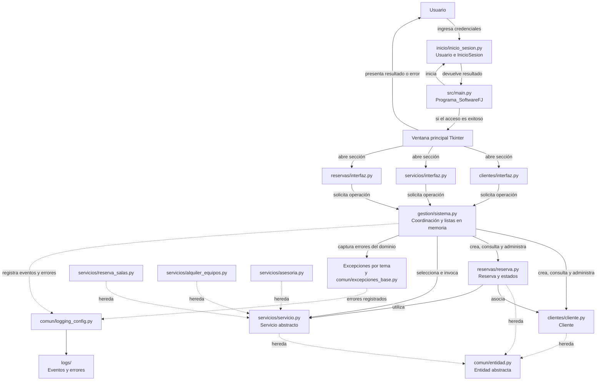

# Sistema Integral de Gestión de Clientes, Servicios y Reservas para la empresa Software FJ

Proyecto académico colaborativo para desarrollar una aplicación orientada a objetos que permita gestionar clientes, servicios y reservas de la empresa **Software FJ** mediante una interfaz gráfica sencilla.

El sistema contiene tres líneas de servicio: **reserva de salas**, **alquiler de equipos** y **asesorías especializadas**. Su diseño debe ser modular, extensible
y resistente a errores: las operaciones inválidas se informan y registran sin interrumpir el funcionamiento general de la aplicación.


## Contexto y propósito

El proyecto busca desarrollar un sistema para la empresa Software FJ, capaz de gestionar clientes, servicios y reservas mediante programación orientada a objetos.

La información se administra durante la ejecución utilizando objetos y listas internas, sin emplear bases de datos. Los archivos se utilizan únicamente para registrar eventos y errores generados durante el funcionamiento del programa.


## Objetivos

- Modelar entidades del dominio mediante clases con responsabilidades claras.
- Aplicar abstracción, herencia, polimorfismo y encapsulación.
- Validar los datos y parámetros antes de aceptar operaciones.
- Crear, confirmar, cancelar y procesar reservas asociadas a clientes y
  servicios.
- Comunicar errores de dominio mediante excepciones personalizadas.
- Registrar eventos relevantes y errores en archivos dentro de `src/logs/`.
- Mantener la aplicación operativa cuando una entrada o una operación falle.
- Integrar las funciones en una interfaz gráfica con Tkinter y demostrar al
  menos diez operaciones completas, exitosas y fallidas.

## Alcance funcional

### Gestión de clientes

La clase abstracta `Entidad`, ubicada en `src/comun/entidad.py`, define lo que
comparten las entidades del sistema, por ejemplo, un identificador. No se crean
objetos directamente a partir de ella: sirve como base para que `Cliente`,
`Servicio` y `Reserva` hereden esos elementos y completen su propio
comportamiento. Puede declarar una operación común, como `describir()`, que
cada una de esas clases implementará a su manera.

`Cliente`, en `src/clientes/cliente.py`, especializa `Entidad` y encapsula los
datos personales. Sus operaciones deben validar la información para evitar
valores inválidos o incompletos. La pantalla o formulario de clientes se
organiza en `src/clientes/interfaz.py`, y los errores propios de este tema en
`src/clientes/excepciones.py`.

### Gestión de servicios

La clase abstracta `Servicio`, en `src/servicios/servicio.py`, hereda de
`Entidad` y define el comportamiento común de los servicios.
Las clases concretas representan:

1. Reserva de salas.
2. Alquiler de equipos.
3. Asesorías especializadas.

Cada especialización debe sobrescribir los métodos para calcular costos,
describir el servicio y validar sus parámetros. De esta manera, el sistema
puede trabajar con la interfaz general `Servicio` y delegar el comportamiento
particular a cada clase. La interfaz de esta sección se encuentra en
`src/servicios/interfaz.py`, y sus errores específicos en
`src/servicios/excepciones.py`.

### Gestión de reservas

`Reserva`, ubicada en `src/reservas/reserva.py`, especializa `Entidad` y
representa la relación entre un cliente y un servicio, junto con la duración,
la información necesaria para procesarla y su estado. Debe controlar las
transiciones permitidas y ofrecer operaciones para crear, confirmar, cancelar y
procesar reservas. La interfaz y los errores de este tema se organizan en
`src/reservas/interfaz.py` y `src/reservas/excepciones.py`, respectivamente.

Una transición no permitida, un dato inconsistente o un servicio no disponible
debe producir una excepción controlada y quedar registrado cuando corresponda.

### Inicio de sesión

`src/inicio/inicio_sesion.py` contendrá las clases `Usuario` e `InicioSesion` y
la función `Abrir_Ventana_Inicio_Sesion()`. Esta función abrirá la ventana de
acceso y devolverá `True` si las credenciales de demostración son válidas o
`False` si se cierra el login sin iniciar sesión. Ante credenciales incorrectas,
la ventana informará el error y permitirá volver a intentarlo. Las credenciales
de prueba se definirán para el ejercicio y no deben contener contraseñas reales.

### Menú e integración

`src/main.py` será el único punto de entrada de la aplicación. Iniciará el
registro común, abrirá el inicio de sesión y, si el acceso es exitoso, mostrará
la ventana principal de Tkinter. Desde esa ventana se podrá acceder a las
interfaces de clientes, servicios y reservas.

Cada integrante implementará la interfaz y las operaciones de su tema, y
agregará a `main.py` únicamente la opción de navegación y la llamada a su propia
interfaz. Las tres trabajarán sobre la misma ventana principal y la misma
instancia de `SistemaGestion`; no crearán ventanas principales ni bucles de
eventos alternativos.

`src/gestion/sistema.py` coordinará las operaciones de clientes, servicios y
reservas y mantendrá las listas internas durante la ejecución. El miembro 3
preparará esta coordinación con los contratos acordados por el equipo; no
reemplaza las clases de cada tema ni contiene sus reglas específicas. La
interfaz deberá permitir continuar utilizando el programa cuando ocurran
errores recuperables.

### Registro y manejo de errores

Cada tema define sus errores en su propio archivo `excepciones.py`. Las
excepciones específicas heredan de `ErrorSistema`, definida en
`src/comun/excepciones_base.py`. En esa misma carpeta,
`logging_config.py` configura una sola vez el registro. Todos los módulos envían
los errores y eventos relevantes al mismo archivo, `src/logs/software_fj.log`;
este registro no almacena los datos de clientes, servicios o reservas.

El flujo de la aplicación debe aplicar, según el caso, bloques `try/except`, `try/except/else` y `try/except/finally`, además de encadenamiento de excepciones cuando un error de bajo nivel se transforme en uno del dominio.
Los errores no deben ocultarse ni convertirse en resultados que aparenten éxito.

## Arquitectura y estructura propuesta

```text
Sistema-Gestion-Software-FJ/
├── src/
│   ├── main.py
│   ├── inicio/
│   │   └── inicio_sesion.py
│   ├── clientes/
│   │   ├── cliente.py
│   │   ├── interfaz.py
│   │   └── excepciones.py
│   ├── servicios/
│   │   ├── servicio.py
│   │   ├── reserva_salas.py
│   │   ├── alquiler_equipos.py
│   │   ├── asesoria.py
│   │   ├── interfaz.py
│   │   └── excepciones.py
│   ├── reservas/
│   │   ├── reserva.py
│   │   ├── interfaz.py
│   │   └── excepciones.py
│   ├── gestion/
│   │   └── sistema.py
│   ├── comun/
│   │   ├── entidad.py
│   │   ├── excepciones_base.py
│   │   └── logging_config.py
│   └── logs/
│       └── .gitkeep
├── .gitignore
└── README.md
```

> Este árbol muestra la organización de los módulos del proyecto. Los archivos
> que solo contienen una descripción inicial son esqueletos; las clases y
> funciones indicadas deben implementarse en el trabajo de cada tema.

Los archivos `interfaz.py` se ubican directamente en la carpeta de su tema; no
se necesita crear otra carpeta solo para la interfaz. De igual manera,
`__init__.py` es un archivo opcional dentro de una carpeta, no una subcarpeta.
Para mantener esta estructura simple se omite: con Python 3.3 o posterior, los
módulos del proyecto pueden importarse desde `src/` sin ese archivo.

### Responsabilidad de las carpetas

- **`comun/`** contiene `Entidad`, la clase abstracta base compartida por
  `Cliente`, `Servicio` y `Reserva`; también contiene `ErrorSistema`, la clase
  base de las excepciones propias, y la configuración central del log.
- **`clientes/`** agrupa `Cliente`, la interfaz de clientes y sus excepciones.
- **`servicios/`** agrupa la clase abstracta `Servicio`, los tres servicios
  especializados, su interfaz y sus excepciones. No se requieren subcarpetas
  adicionales para cada servicio.
- **`reservas/`** agrupa la clase `Reserva`, la interfaz de reservas y sus
  excepciones.
- **`gestion/sistema.py`** coordina las operaciones y conserva las listas de
  clientes, servicios y reservas en memoria. No reemplaza las clases de dominio
  ni contiene sus reglas específicas.
- **`logs/`** recibe `software_fj.log`, configurado desde `logging_config.py`.
  `.gitkeep` conserva la carpeta en el repositorio; el log no es una base de
  datos.

### Diagrama de arquitectura

La aplicación separa la ventana principal, las interfaces de cada tema y la
lógica de dominio. La capa de gestión coordina las operaciones; las excepciones
y el registro común acompañan el flujo sin almacenar los datos del negocio en
archivos.



### Diagrama de flujo de datos


Los clientes, servicios y reservas viven en las colecciones del sistema durante la ejecución. Los archivos de `src/logs/` guardan únicamente trazas de eventos y errores relevantes: no son una base de datos ni una fuente de persistencia del negocio. Cuando una operación falla, no debe dejar cambios parciales en las
listas o en el estado de una reserva.

El flujo de gestión posterior al inicio de sesión representa el alcance previsto
del sistema. Las opciones de clientes, servicios y reservas todavía deben
integrarse en la ventana principal.


## Distribución del trabajo y responsabilidades

La distribución se organiza entre tres miembros, uno por cada tema principal.
Cada persona desarrolla la lógica, las validaciones, las excepciones propias y
la interfaz de su tema. Las tareas compartidas se asignan explícitamente en la
tabla; la integración se prueba en equipo y no implica volver a implementar
el trabajo de otra persona.

| Integrante | Tema principal | Archivos y tareas asignadas | Aporte a documentación y pruebas |
|---|---|---|---|
| **1** | Clientes, inicio de sesión, estructura inicial del programa y documentación | `src/clientes/`; `src/inicio/inicio_sesion.py`; estructura inicial de `src/main.py`; `README.md`. Implementa `Cliente`, sus validaciones, excepciones e interfaz; desarrolla el inicio de sesión; prepara la ventana y el menú base de `main.py`, y agrega la opción de Clientes. Tiene a su cargo la redacción, organización y actualización del README. | Documenta el proyecto de principio a fin; prueba el inicio de sesión y los casos válidos e inválidos de clientes. |
| **2** | Servicios y clase abstracta común | `src/comun/entidad.py`; `src/servicios/`; `src/comun/excepciones_base.py`. Implementa `Entidad` como clase abstracta compartida —acordando su contrato con los otros miembros—, la clase abstracta `Servicio`, los tres servicios especializados, sus validaciones, excepciones e interfaz. También agrega la opción de Servicios en `main.py`. | Documenta el modelo de entidades y los servicios; prueba las validaciones, excepciones y variantes de costos de los tres servicios. |
| **3** | Reservas e integración del sistema | `src/reservas/`; `src/gestion/sistema.py`; `src/comun/logging_config.py`; `src/logs/`. Implementa `Reserva`, sus validaciones, excepciones e interfaz; coordina las listas y operaciones comunes, configura el registro y conecta la opción de Reservas en `main.py`. | Documenta las reservas, la gestión y el registro; coordina la revisión final de integración y las pruebas integrales. |

El README queda exclusivamente a cargo del miembro 1. Los miembros 2 y 3 no
tienen tareas de redacción, edición ni revisión del README.

**Regla de integración del `main`:** los tres miembros modifican el mismo
`src/main.py`, cada uno en la sección acordada: el miembro 1 prepara la
estructura base, el inicio de sesión y la opción de Clientes; el miembro 2
define la clase base `Entidad` y conecta la opción de Servicios; y el miembro
3 conecta Reservas, la instancia compartida de `SistemaGestion` y el registro.
Cada interfaz debe poder abrirse desde esa ventana y recibir la misma instancia
del sistema cuando la necesite. Para evitar conflictos, acuerden los nombres de
los métodos y trabajen los cambios de `main.py` por turnos o mediante ramas
separadas. Debe existir una sola ventana principal y una sola llamada al bucle
de eventos de Tkinter.

**Trabajo compartido:** el equipo acuerda los nombres y parámetros de las
operaciones, las excepciones y el formato de los registros antes de integrar.
Cada miembro prueba su tema; luego el equipo ejecuta y verifica al menos
diez operaciones completas. Los errores y eventos relevantes de todos los
temas se escriben en el mismo archivo configurado en `logging_config.py`.

### Acuerdos de integración

- Coordinar antes de implementar los nombres de clases, métodos, atributos y
  excepciones que se intercambiarán entre módulos.
- Definir en `Entidad` solo los atributos y el contrato que realmente comparten
  Cliente, Servicio y Reserva; cada clase derivada implementa sus métodos
  abstractos.
- Mantener las clases de dominio enfocadas en sus propias reglas; centralizar la
  coordinación del sistema en `src/gestion/sistema.py`.
- Definir las excepciones específicas en cada tema y hacer que hereden de la
  excepción base compartida en `src/comun/excepciones_base.py`.
- Configurar el archivo de registro una sola vez mediante
  `src/comun/logging_config.py`; los tres temas deben escribir en el mismo log
  dentro de `src/logs/`.
- Usar imports de paquete consistentes con la ejecución desde la raíz del
  proyecto.
- Acordar qué errores son recuperables en el menú y qué información debe
  registrarse en los logs.
- Integrar y probar el flujo completo, además de las pruebas individuales de cada módulo.

## Requisitos de diseño

1. **Abstracción e herencia:** `Entidad` y `Servicio` deben ser clases
   abstractas. `Cliente`, `Servicio` y `Reserva` heredan de `Entidad`; los tres
   servicios concretos heredan de `Servicio`.
2. **Polimorfismo:** los servicios especializados deben implementar sus
   variaciones de descripción, validación de parámetros y cálculo de costos
   mediante métodos sobrescritos.
3. **Encapsulación:** los datos personales del cliente y el estado de la reserva
   no deben modificarse sin pasar por las operaciones y validaciones previstas.
4. **Validación estricta:** verificar datos requeridos, tipos, rangos,
   consistencia entre cliente/servicio/reserva y disponibilidad antes de
   completar una operación.
5. **Variantes de cálculo (sobrecarga):** permitir calcular el costo base y
   también aplicar impuestos o descuentos. Python no selecciona métodos
   diferentes por firma como otros lenguajes; para este ejercicio, se pueden
   ofrecer variantes mediante parámetros opcionales, por ejemplo
   `calcular_costo(impuesto=..., descuento=...)`, y sobrescribir ese método en
   cada servicio especializado. Documentar y probar las variantes elegidas.
6. **Colecciones internas:** administrar los objetos del sistema mediante
   listas u otras estructuras en memoria, sin incorporar una base de datos.
7. **Excepciones y continuidad:** detectar entradas inválidas y operaciones no
   permitidas, comunicar el error y permitir que el usuario continúe cuando sea
   seguro hacerlo.
8. **Registro:** registrar todos los errores y los eventos relevantes en el
   archivo común `src/logs/software_fj.log`, usando la configuración de
   `src/comun/logging_config.py`; no almacenar allí información del negocio.

## Plan de demostración: mínimo diez operaciones

La entrega debe ejecutar y documentar al menos diez operaciones completas. La
lista incluye once casos para cubrir también las variantes del cálculo de
costos. El equipo puede ajustar los datos concretos, pero debe conservar casos
válidos, inválidos y fallidos.

| N.º | Operación a demostrar | Resultado esperado |
|---:|---|---|
| 1 | Registrar un cliente con datos válidos. | Cliente creado y disponible para las siguientes operaciones. |
| 2 | Intentar registrar un cliente con datos inválidos o incompletos. | Validación rechaza la operación, informa el error y permite continuar. |
| 3 | Crear un servicio válido de reserva de salas. | Servicio aceptado con sus parámetros válidos. |
| 4 | Intentar crear un servicio con parámetros inválidos. | Se genera un error controlado y se registra el evento o error. |
| 5 | Crear un servicio válido de alquiler de equipos. | Servicio disponible en el sistema. |
| 6 | Crear un servicio válido de asesoría especializada. | Servicio disponible en el sistema. |
| 7 | Crear una reserva válida para un cliente y un servicio existentes. | Reserva creada con estado inicial coherente. |
| 8 | Confirmar y procesar una reserva válida. | Se ejecutan las transiciones permitidas y el procesamiento esperado. |
| 9 | Intentar crear o procesar una reserva con datos inconsistentes, servicio no disponible u operación no permitida. | La excepción se maneja sin detener el programa y queda registrada. |
| 10 | Cancelar una reserva válida y consultar el estado final. | Cancelación reflejada correctamente; el sistema continúa disponible. |
| 11 | Calcular el costo de un servicio con distintas combinaciones de impuestos y descuentos. | Se comprueban las variantes de cálculo acordadas y el comportamiento polimórfico de cada servicio. |

En cada caso se recomienda verificar tanto el resultado observable (mensaje,
objeto o estado) como el efecto en las listas internas y en los registros cuando
aplique. Los casos fallidos deben demostrar que el sistema no queda en un estado
parcialmente actualizado.

## Ejecución

La aplicación se ejecutará desde el directorio raíz del proyecto con Python:

```powershell
python src/main.py
```

Al iniciar, se mostrará la ventana de inicio de sesión. Con credenciales de
demostración válidas, el login se cerrará y se abrirá la ventana principal de
Software FJ, desde la que se accederá a las funciones de clientes, servicios y
reservas.

El proyecto no utiliza base de datos. La información de clientes, servicios y reservas permanece en memoria durante la ejecución del programa.

La interfaz gráfica se desarrollará con Tkinter, disponible dentro de la biblioteca estándar de Python, por lo que no se requieren dependencias externas adicionales para su funcionamiento.

## Registros y archivos generados

La carpeta `src/logs/` se utilizará para almacenar los registros de eventos y errores generados durante la ejecución del programa.

- Mantener `src/logs/.gitkeep` para conservar el directorio vacío en el control de
  versiones.
- Crear los archivos de log durante la ejecución, según la configuración acordada por el equipo.
- Registrar errores y eventos relevantes, como operaciones completadas, intentos rechazados y fallos de procesamiento.
- Evitar incluir datos personales completos en los mensajes de registro.
- Excluir mediante `.gitignore` los archivos de log generados durante la ejecución, conservando únicamente `.gitkeep` dentro del repositorio.

Los archivos de log no se utilizarán como base de datos ni como mecanismo para almacenar clientes, servicios o reservas. La información del sistema se administrará mediante objetos y listas internas durante la ejecución.

## Criterios de aceptación

- [ ] `Entidad` es abstracta y la heredan `Cliente`, `Servicio` y `Reserva`;
  `Servicio` también es abstracta y tiene al menos tres servicios derivados.
- [ ] El inicio de sesión permite reintentar si las credenciales son incorrectas
  y devuelve el resultado de la validación al programa principal.
- [ ] Tras un inicio de sesión exitoso, se destruye la ventana de login y se
  crea la ventana principal.
- [ ] Los datos y las operaciones tienen validaciones estrictas.
- [ ] Los servicios aplican polimorfismo en sus comportamientos específicos.
- [ ] Cada servicio especializado sobrescribe el cálculo del costo, la
  descripción y la validación de sus parámetros.
- [ ] Las reservas controlan estados y transiciones permitidas.
- [ ] Se demuestra una variante de método sobrecargado, adaptada a Python.
- [ ] Se prueban los cálculos con y sin los parámetros opcionales acordados.
- [ ] Se manejan excepciones personalizadas y las formas de bloques de excepción
  solicitadas en el anexo.
- [ ] Todos los errores y los eventos relevantes quedan registrados en el
  archivo común de log.
- [ ] La aplicación continúa después de los errores recuperables.
- [ ] Se ejecutan y verifican al menos diez operaciones completas, incluyendo
  casos exitosos y fallidos.
- [ ] La solución funciona sin base de datos y la documentación corresponde a
  la implementación integrada.

## Referencia del ejercicio

Este README se basa en el **Anexo 3 — Problema a desarrollar Fase 4**, curso de
Programación UNAD (código 213023), que plantea el desarrollo en equipo de un sistema
integral de gestión de clientes, servicios y reservas para Software FJ.
