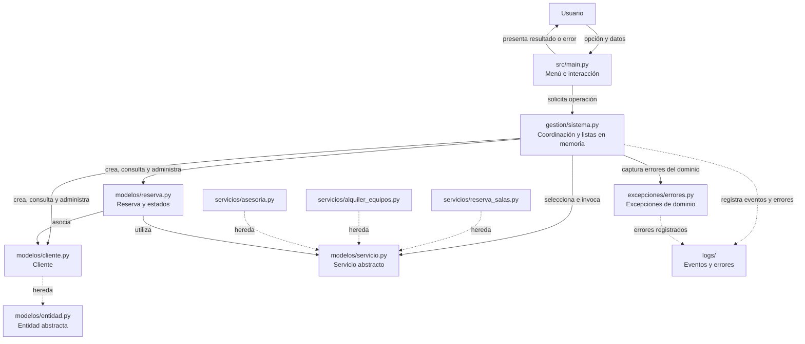
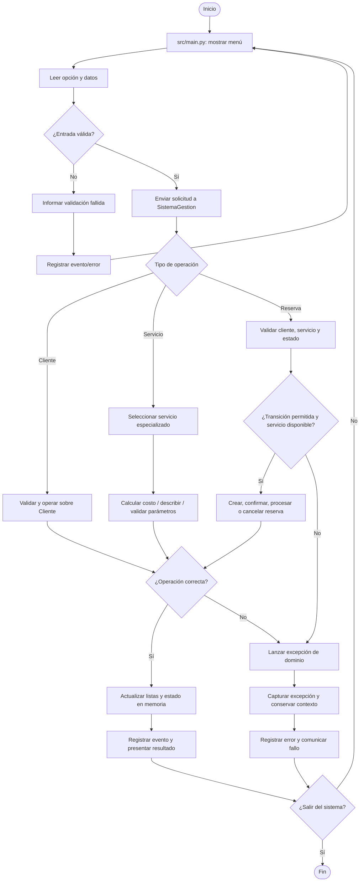

# Sistema Integral de Gestión de Clientes, Servicios y Reservas — Software FJ

Proyecto académico de Programación (UNAD) para diseñar una aplicación de consola
orientada a objetos que gestione clientes, servicios y reservas de la empresa
ficticia **Software FJ**.

El sistema contempla tres líneas de servicio: **reserva de salas**, **alquiler de
equipos** y **asesorías especializadas**. Su diseño debe ser modular, extensible
y resistente a errores: las operaciones inválidas se informan y registran sin
interrumpir el funcionamiento general de la aplicación.

> **Estado del repositorio:** este documento describe la arquitectura objetivo,
> los requisitos del ejercicio y la distribución de trabajo. En `src/` se
> encuentra el esqueleto inicial de paquetes y módulos; sus funciones todavía
> deben implementarse e integrarse.

## Contexto y propósito

El ejercicio propone que un equipo de cinco estudiantes construya una solución
integral sin motor de base de datos. El propósito es aplicar de forma práctica
los principios de programación orientada a objetos y el manejo avanzado de
excepciones en un caso de gestión empresarial.

La aplicación debe permitir administrar la información en memoria mediante
objetos y listas internas. Los archivos se reservan para el registro de eventos
y errores; no se deben usar como sustituto de una base de datos para persistir
clientes, servicios o reservas. Al cerrar el programa, los datos de negocio
mantenidos únicamente en memoria no necesariamente estarán disponibles en la
siguiente ejecución.

## Objetivos

- Modelar entidades del dominio mediante clases con responsabilidades claras.
- Aplicar abstracción, herencia, polimorfismo y encapsulación.
- Validar los datos y parámetros antes de aceptar operaciones.
- Crear, confirmar, cancelar y procesar reservas asociadas a clientes y
  servicios.
- Comunicar errores de dominio mediante excepciones personalizadas.
- Registrar eventos relevantes y errores en archivos dentro de `src/logs/`.
- Mantener la aplicación operativa cuando una entrada o una operación falle.
- Integrar las funciones en un menú de consola y demostrar al menos diez
  operaciones completas, exitosas y fallidas.

## Alcance funcional

### Gestión de clientes

La clase abstracta `Entidad` establece el concepto y las propiedades comunes a
las entidades del sistema. `Cliente` la especializa y encapsula sus datos
personales, exponiendo únicamente las operaciones definidas por la interfaz de
la clase. Sus datos y cambios deben someterse a validaciones estrictas para
evitar valores inválidos o incompletos.

### Gestión de servicios

La clase abstracta `Servicio` define el comportamiento común de los servicios.
Las clases concretas representan:

1. Reserva de salas.
2. Alquiler de equipos.
3. Asesorías especializadas.

Cada especialización debe sobrescribir los comportamientos que dependan del
tipo de servicio, por ejemplo, su descripción, la validación de sus parámetros
y el cálculo de su costo. De esta manera, el sistema puede trabajar con la
interfaz general `Servicio` y delegar el comportamiento particular a cada
clase.

### Gestión de reservas

`Reserva` representa la relación entre un cliente y un servicio, junto con la
duración, la información necesaria para procesarla y su estado. Debe controlar
las transiciones permitidas y ofrecer operaciones para crear, confirmar,
cancelar y procesar reservas. Una transición no permitida, un dato inconsistente
o un servicio no disponible debe producir un error controlado y quedar
registrado cuando corresponda.

### Menú e integración

`src/main.py` inicia la aplicación y presenta el menú de consola. La capa de
`src/gestion/` coordina clientes, servicios y reservas, conserva las listas
internas de trabajo y conecta las operaciones de cada módulo. El menú debe
validar las entradas y permitir volver a operar después de errores recuperables.

### Registro y manejo de errores

`src/excepciones/` concentra las excepciones propias del dominio. `src/logs/`
contiene los archivos de registro generados durante la ejecución; los errores y
los eventos relevantes deben dejar información suficiente para entender qué
operación ocurrió sin incluir datos personales innecesarios.

El flujo de la aplicación debe aplicar, según el caso, bloques `try/except`,
`try/except/else` y `try/except/finally`, además de encadenamiento de
excepciones cuando un error de bajo nivel se transforme en uno del dominio. Los
errores no deben ocultarse ni convertirse en resultados que aparenten éxito.

## Arquitectura y estructura propuesta

```text
Sistema-Gestion-Software-FJ/
├── src/
│   ├── main.py
│   ├── modelos/
│   │   ├── __init__.py
│   │   ├── entidad.py
│   │   ├── cliente.py
│   │   ├── servicio.py
│   │   └── reserva.py
│   ├── servicios/
│   │   ├── __init__.py
│   │   ├── reserva_salas.py
│   │   ├── alquiler_equipos.py
│   │   └── asesoria.py
│   ├── excepciones/
│   │   ├── __init__.py
│   │   └── errores.py
│   ├── gestion/
│   │   ├── __init__.py
│   │   └── sistema.py
│   └── logs/
│       └── .gitkeep
├── README.md
└── .gitignore
```

> En Python, el nombre convencional del archivo de inicialización de un paquete
> es `__init__.py` (dos guiones bajos a cada lado). Se usa esa forma en el árbol,
> en lugar de `_init_.py`.

### Diagrama de arquitectura

La aplicación se organiza en capas. El punto de entrada recibe las opciones del
usuario; la capa de gestión coordina los objetos y las colecciones en memoria;
los modelos contienen las reglas del dominio. Las excepciones y el registro
acompañan las operaciones para informar y diagnosticar errores sin almacenar
los datos del negocio en archivos.



### Diagrama de flujo de datos



Los clientes, servicios y reservas viven en las colecciones del sistema durante
la ejecución. Los archivos de `src/logs/` guardan únicamente trazas de eventos
y errores relevantes: no son una base de datos ni una fuente de persistencia del
negocio. Cuando una operación falla, no debe dejar cambios parciales en las
listas o en el estado de una reserva.

### Responsabilidades por módulo

| Ruta | Responsabilidad |
|---|---|
| `src/modelos/entidad.py` | Declarar la clase abstracta `Entidad` y el comportamiento común de las entidades. |
| `src/modelos/cliente.py` | Implementar `Cliente`, la encapsulación de sus datos y sus validaciones. |
| `src/modelos/servicio.py` | Declarar la clase abstracta `Servicio` y su interfaz común. |
| `src/modelos/reserva.py` | Representar reservas y controlar su creación, confirmación, cancelación y procesamiento. |
| `src/servicios/reserva_salas.py` | Implementar el servicio especializado de reserva de salas. |
| `src/servicios/alquiler_equipos.py` | Implementar el servicio especializado de alquiler de equipos. |
| `src/servicios/asesoria.py` | Implementar el servicio especializado de asesorías. |
| `src/excepciones/errores.py` | Definir excepciones personalizadas para los errores del dominio. |
| `src/gestion/sistema.py` | Coordinar las listas y operaciones de clientes, servicios y reservas. |
| `src/logs/` | Alojar los registros de ejecución, eventos relevantes y errores. |
| `src/main.py` | Iniciar la aplicación, mostrar el menú y conectar la interacción con el sistema. |

## Distribución del trabajo

La distribución propuesta asigna un módulo principal a cada integrante y
reserva la integración general a la persona responsable del quinto frente. Para
facilitar el trabajo en paralelo, cada módulo debe respetar las interfaces y
los contratos acordados por el equipo.

| Integrante | Frente | Archivos / alcance | Entregable principal |
|---|---|---|---|
| **1** | Desarrollo — Gestión de clientes | `src/modelos/entidad.py`, `src/modelos/cliente.py` | Clase abstracta `Entidad`, clase `Cliente`, encapsulación y validaciones. |
| **2** | Desarrollo — Gestión de servicios | `src/modelos/servicio.py`, `src/servicios/` | Clase abstracta `Servicio` y sus tres clases especializadas. |
| **3** | Desarrollo — Gestión de reservas | `src/modelos/reserva.py` | Creación, confirmación, cancelación y procesamiento de reservas. |
| **4** | Desarrollo — Excepciones y registros | `src/excepciones/`, `src/logs/` | Excepciones personalizadas y registro de eventos y errores. |
| **5** | Integración — Integración y pruebas | `src/gestion/`, `src/main.py`, `README.md` | Menú, integración, pruebas de las diez operaciones y documentación. |

### Acuerdos de integración

- Coordinar antes de implementar los nombres de clases, métodos, atributos y
  excepciones que se intercambiarán entre módulos.
- Mantener las clases de dominio enfocadas en sus propias reglas; centralizar la
  coordinación del sistema en `src/gestion/sistema.py`.
- Usar imports de paquete consistentes con la ejecución desde la raíz del
  proyecto.
- Acordar qué errores son recuperables en el menú y qué información debe
  registrarse en los logs.
- Integrar y probar el flujo completo, además de las pruebas individuales de
  cada módulo.

## Requisitos de diseño

1. **Abstracción e herencia:** `Entidad` y `Servicio` deben ser clases
   abstractas; `Cliente` y los tres servicios concretos deben especializarlas de
   acuerdo con su dominio.
2. **Polimorfismo:** los servicios especializados deben implementar sus
   variaciones de descripción, validación y cálculo de costos mediante métodos
   sobrescritos.
3. **Encapsulación:** los datos personales del cliente y el estado de la reserva
   no deben modificarse sin pasar por las operaciones y validaciones previstas.
4. **Validación estricta:** verificar datos requeridos, tipos, rangos,
   consistencia entre cliente/servicio/reserva y disponibilidad antes de
   completar una operación.
5. **Métodos sobrecargados:** demostrar variantes de una operación, como el
   cálculo de costos con parámetros opcionales, impuestos o descuentos. Como
   Python no ofrece sobrecarga tradicional de métodos por firma, el equipo debe
   resolverlo con una interfaz clara (por ejemplo, parámetros opcionales) y
   documentar el comportamiento elegido.
6. **Colecciones internas:** administrar los objetos del sistema mediante
   listas u otras estructuras en memoria, sin incorporar una base de datos.
7. **Excepciones y continuidad:** detectar entradas inválidas y operaciones no
   permitidas, comunicar el error y permitir que el usuario continúe cuando sea
   seguro hacerlo.
8. **Registro:** registrar eventos relevantes y errores en archivos dentro de
   `src/logs/`; no almacenar allí la información como mecanismo de persistencia del
   negocio.

## Plan de demostración: diez operaciones

La entrega debe ejecutar y documentar al menos diez operaciones completas. Esta
lista sirve como base para las pruebas de integración; el equipo puede ajustar
los datos concretos, pero debe conservar casos válidos, inválidos y fallidos.

| N.º | Operación a demostrar | Resultado esperado |
|---:|---|---|
| 1 | Registrar un cliente con datos válidos. | Cliente creado y disponible para las siguientes operaciones. |
| 2 | Intentar registrar un cliente con datos inválidos o incompletos. | Validación rechaza la operación, informa el error y permite continuar. |
| 3 | Crear un servicio válido de reserva de salas. | Servicio aceptado con sus parámetros válidos. |
| 4 | Intentar crear un servicio con parámetros inválidos. | Se genera un error controlado y se registra el evento o error. |
| 5 | Crear un servicio válido de alquiler de equipos. | Servicio disponible en el sistema. |
| 6 | Crear un servicio válido de asesoría especializada. | Servicio disponible en el sistema. |
| 7 | Crear una reserva válida para un cliente y un servicio existentes. | Reserva creada con estado inicial coherente. |
| 8 | Confirmar y procesar una reserva válida. | Se ejecutan las transiciones permitidas y el procesamiento esperado. |
| 9 | Intentar crear o procesar una reserva con datos inconsistentes, servicio no disponible u operación no permitida. | La excepción se maneja sin detener el programa y queda registrada. |
| 10 | Cancelar una reserva válida y consultar el estado final. | Cancelación reflejada correctamente; el sistema continúa disponible. |

En cada caso se recomienda verificar tanto el resultado observable (mensaje,
objeto o estado) como el efecto en las listas internas y en los registros cuando
aplique. Los casos fallidos deben demostrar que el sistema no queda en un estado
parcialmente actualizado.

## Ejecución

La aplicación está prevista para ejecutarse desde el directorio raíz del
proyecto con Python:

```powershell
python src/main.py
```

Una vez integrados los módulos, el programa debe iniciar el menú principal y
permitir realizar las operaciones soportadas. El ejercicio no requiere motor de
base de datos ni dependencias externas especificadas en este README. Si el
equipo incorpora alguna dependencia, debe documentar su instalación y uso aquí.

## Registros y archivos generados

- Mantener `src/logs/.gitkeep` para conservar el directorio vacío en el control de
  versiones.
- Crear los archivos de log durante la ejecución, según la configuración que
  acuerde el equipo.
- Registrar errores y eventos relevantes, como operaciones completadas,
  intentos rechazados y fallos de procesamiento.
- Evitar incluir datos personales completos en los mensajes de registro.
- Excluir del repositorio los logs generados y otros archivos temporales
  mediante `.gitignore`, conservando el `.gitkeep`.

## Criterios de aceptación

- [ ] La arquitectura incluye las clases abstractas, derivadas y módulos
  descritos.
- [ ] Los datos y las operaciones tienen validaciones estrictas.
- [ ] Los servicios aplican polimorfismo en sus comportamientos específicos.
- [ ] Las reservas controlan estados y transiciones permitidas.
- [ ] Se demuestra una variante de método sobrecargado, adaptada a Python.
- [ ] Se manejan excepciones personalizadas y las formas de bloques de excepción
  solicitadas en el anexo.
- [ ] Los errores y eventos relevantes quedan registrados en archivos de log.
- [ ] La aplicación continúa después de los errores recuperables.
- [ ] Se ejecutan y verifican al menos diez operaciones completas, incluyendo
  casos exitosos y fallidos.
- [ ] La solución funciona sin base de datos y la documentación corresponde a
  la implementación integrada.

## Referencia del ejercicio

Este README se basa en el **Anexo 3 — Problema a desarrollar Fase 4**, curso de
Programación (código 213023), que plantea el desarrollo en equipo de un sistema
integral de gestión de clientes, servicios y reservas para Software FJ.
